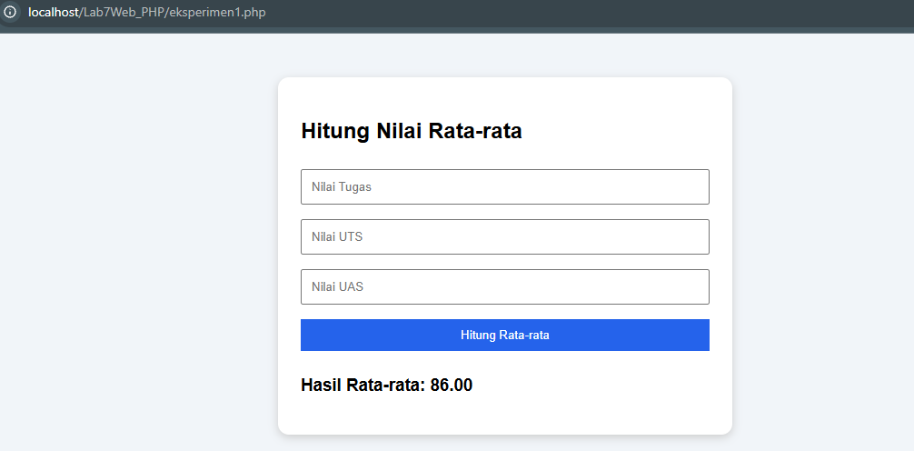
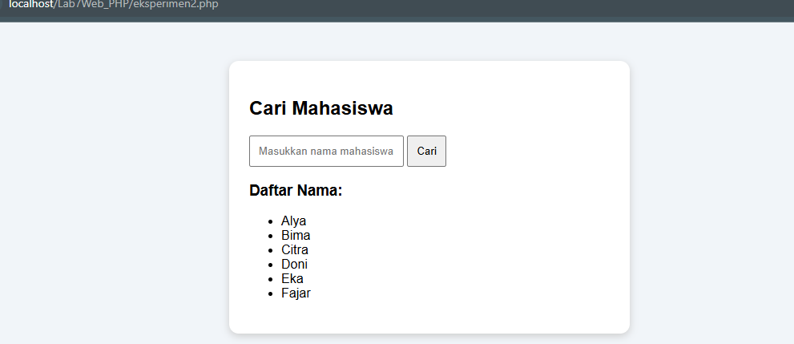
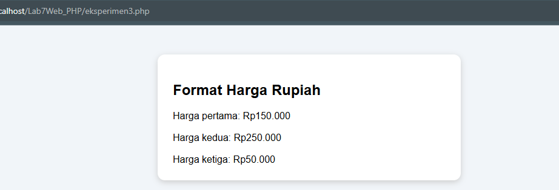
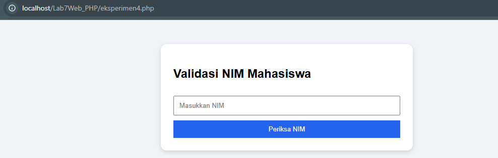
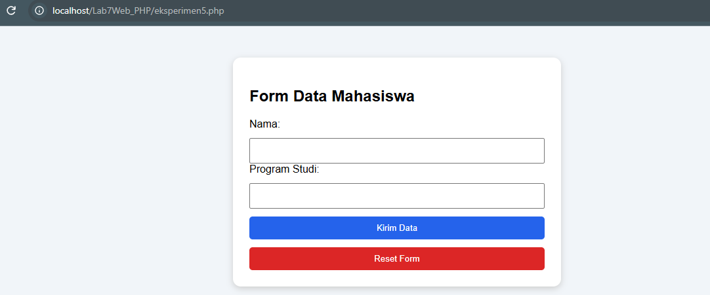

# PRAKTIKUM 7 - PEMROGRAMAN SERVER-SIDE DENGAN PHP

## A. Identitas
- Mata Kuliah: Pemrograman Web
- Praktikum: 7
- Materi: Pemrograman Server-Side dengan PHP

## B. Tujuan Praktikum
1. Memahami pemrograman server-side menggunakan PHP.
2. Memahami variabel, operator, percabangan, dan perulangan.
3. Mempelajari penggunaan function dalam PHP.
4. Memahami pemrosesan form menggunakan GET dan POST.
5. Melakukan validasi dan pengolahan data pengguna.

## C. Perangkat yang Digunakan
- Laptop/PC
- Visual Studio Code
- XAMPP
- PHP
- Google Chrome

## D. Cara Menjalankan Program
1. Buka aplikasi XAMPP.
2. Jalankan Apache.
3. Simpan folder proyek di C:\xampp\htdocs.
4. Buka folder Lab7Web_PHP menggunakan VS Code.
5. Buka browser Google Chrome.
6. Masukkan alamat localhost sesuai file yang ingin dijalankan.

## E. Daftar Program

| No | Nama File | Keterangan |
|---|---|---|
| 1 | latihan1.php | Menjalankan PHP |
| 2 | latihan2.php | Variabel, operator, percabangan |
| 3 | latihan3.php | Perulangan dan array |
| 4 | latihan4.php | Function |
| 5 | latihan5.php | Form GET |
| 6 | latihan6.php | Form POST |
| 7 | latihan7.php | Pengolahan data barang |
| 8 | mini_project.php | Formulir data mahasiswa |
| 9 | eksperimen1.php | Menghitung nilai rata-rata |
| 10 | eksperimen2.php | Pencarian nama mahasiswa |
| 11 | eksperimen3.php | Format harga Rupiah |
| 12 | eksperimen4.php | Validasi NIM |
| 13 | eksperimen5.php | Tombol reset form |

## F. Dokumentasi Hasil Praktikum

Bagian ini berisi screenshot hasil program yang telah dijalankan melalui browser menggunakan localhost.

### 1. Hasil Latihan 1 - Menjalankan PHP

### 2. Hasil Latihan 2 - Variabel dan Percabangan

### 3. Hasil Latihan 3 - Perulangan dan Array

### 4. Hasil Latihan 4 - Function

### 5. Hasil Latihan 5 - Form GET

### 6. Hasil Latihan 6 - Form POST

### 7. Hasil Latihan 7 - Pengolahan Data Barang

### 8. Hasil Mini Project - Form Data Mahasiswa

### 9. Hasil Eksperimen 1 - Nilai Rata-rata

### 10. Hasil Eksperimen 2 - Pencarian Mahasiswa

### 11. Hasil Eksperimen 3 - Format Rupiah

### 12. Hasil Eksperimen 4 - Validasi NIM

### 13. Hasil Eksperimen 5 - Tombol Reset

## G. Pengujian Program

### Input Valid
1. Memasukkan nama mahasiswa dan program studi dengan benar.
2. Memasukkan harga barang dan jumlah barang yang sesuai.

### Input Tidak Valid
1. Memasukkan semester di luar rentang 1 sampai 14.
2. Memasukkan email dengan format yang salah.
3. Memasukkan NIM yang mengandung huruf.

## H. Kesimpulan

Melalui praktikum ini, saya dapat memahami dasar pemrograman server-side menggunakan PHP. Saya juga dapat membuat program menggunakan variabel, percabangan, perulangan, function, serta memproses data menggunakan form GET dan POST. Selain itu, saya dapat membuat aplikasi sederhana untuk mengolah dan memvalidasi data mahasiswa menggunakan PHP.

## Jawaban Pertanyaan Evaluasi

1. Apa perbedaan pemrosesan client-side dan server-side?

Client-side adalah proses yang dijalankan di browser pengguna, seperti HTML, CSS, dan JavaScript. Server-side adalah proses yang dijalankan di server, seperti PHP, untuk menerima dan mengolah data pengguna.

2. Mengapa file PHP harus dijalankan melalui web server?

Karena PHP merupakan bahasa pemrograman server-side yang membutuhkan web server untuk memproses kode PHP sebelum hasilnya ditampilkan di browser.

3. Apa fungsi tanda $ pada variabel PHP?

Tanda $ digunakan sebagai awalan untuk mendeklarasikan dan mengakses variabel dalam PHP.

4. Apa perbedaan metode GET dan POST?

GET mengirimkan data melalui URL sehingga data dapat terlihat pada alamat browser. POST mengirimkan data melalui body permintaan HTTP sehingga tidak ditampilkan pada URL.

5. Mengapa input pengguna perlu divalidasi di sisi server?

Untuk memastikan data yang diterima sesuai dengan ketentuan dan mencegah data yang tidak valid diproses oleh sistem.

6. Apa fungsi htmlspecialchars()?

Untuk mengubah karakter khusus HTML menjadi bentuk yang aman ketika ditampilkan kembali, sehingga membantu mencegah injeksi HTML atau script.

7. Apa manfaat penggunaan function dalam program PHP?

Function membantu membuat kode lebih terstruktur, mengurangi pengulangan kode, dan mempermudah pemeliharaan program.